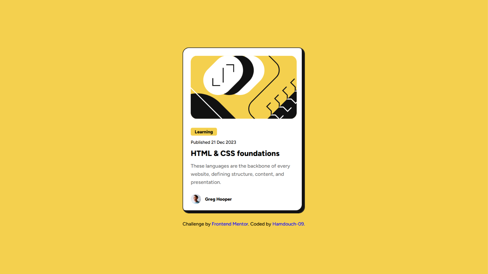
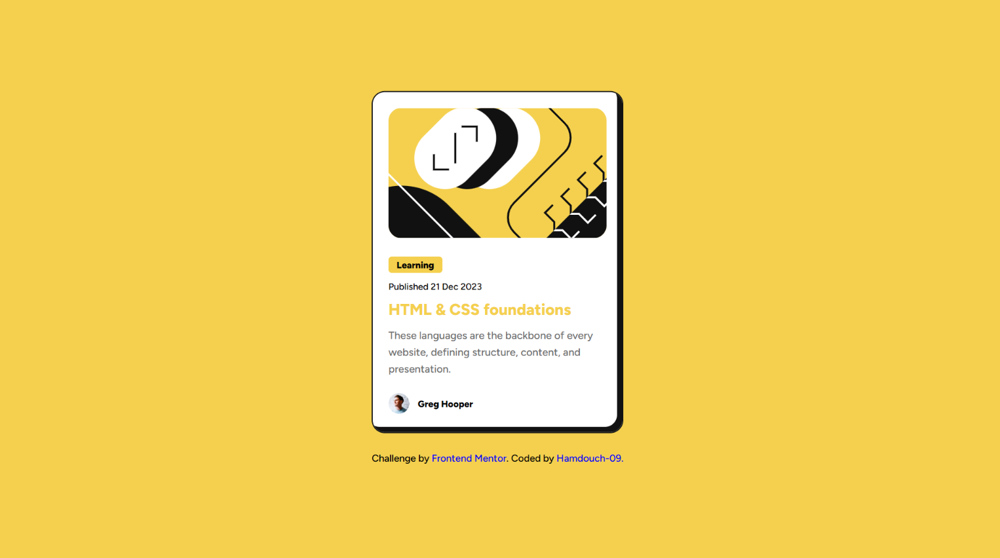
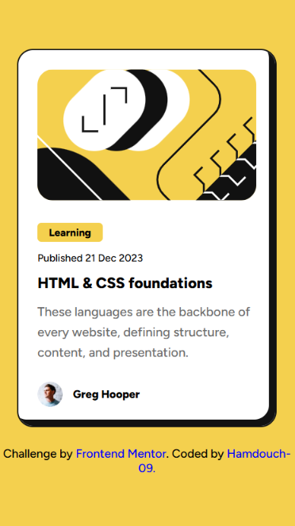

# Frontend Mentor - Blog preview card solution

This is a solution to the [Blog preview card challenge on Frontend Mentor](https://www.frontendmentor.io/challenges/blog-preview-card-ckPaj01IcS). Frontend Mentor challenges help you improve your coding skills by building realistic projects.

## Table of contents

- [Overview](#overview)
  - [The challenge](#the-challenge)
  - [Screenshot](#screenshot)
  - [Links](#links)
- [My process](#my-process)
  - [Built with](#built-with)
  - [What I Learned and Challenges](#what-i-learned-and-challenges)
  - [Continued development](#continued-development)
  - [AI Collaboration](#ai-collaboration)
- [Author](#author)
- [Acknowledgments](#acknowledgments)

## Overview

- A solution to the Blog Preview Card challenge on Frontend Mentor, focused on building a clean, accurate, and responsive card component using core web technologies to strengthen front-end development skills.

### The challenge

- responsive blog preview card that closely matches the intended design across screen sizes.
- Implement hover states for interactive elements within the card.

### Screenshot





### Links

- [solution URL](https://www.frontendmentor.io/solutions/responsive-blog-preview-card-using-flex-m7RoLy20z-)
- [live site URL](https://hamdouch-09.github.io/Blog-preview-card/)

## My process

I started by reviewing the mobile and desktop designs, then structured the content using semantic HTML. I styled the card with CSS custom properties, local Figtree fonts, and Grid and Flexbox for the layout. I added responsive rules for smaller screens and used clamp() to adjust text sizes.

### Built with

- Semantic HTML5 markup
- CSS custom properties
- Flexbox
- CSS Grid
- Desktop-first workflow
- CSS3 (custom variables, responsive layout, and interactive states)

### What I Learned and Challenges

- Faced challenges choosing accessible HTML elements—such as finding the right element for the date before settling on the `<time>` tag.

```html
<time datetime="2023-12-21">Published 21 Dec 2023</time>
```

- Had to decide on the best container for the card and chose `<article>` over `<section>` since it better fits self-contained content.

```html
<article class="card"></article>
```

- Ran into width issues on screens narrower than `375px`, so I structured
  the layout to support viewports down to around `320px` (beyond the
  `360px–375px` baseline) to help smaller/older screens (like older iPhone SE
  models) and zoomed views.
- Used the CSS `clamp()` function for fluid font
  sizing across screen sizes without relying on extra media queries for that
  purpose.

```css
h1 {
  margin-top: 0.75rem;
  font-size: clamp(19px, 3vw, 24px);
  font-weight: bold;
  transition: all 0.2s linear;
}
```

- Fixed an issue with a rigid element height leaving extra space by using `height: auto` on mobile screens for cleaner spacing and layout.

### Continued development

In the future, I aim to grow my front-end development skills, focusing on CSS and JavaScript. Responsive layouts and several CSS concepts still feel challenging at times, so building more projects and practicing them is a key focus for me going forward.

### AI Collaboration

Used GitHub Copilot in VS Code at the end of the project to review the code and ensure there were no errors or issues.

## Author

- Frontend Mentor - [@Hamdouch-09](https://www.frontendmentor.io/profile/Hamdouch-09)
- Twitter - [@Hmadouch_09](https://x.com/Hmadouch_09)

## Acknowledgments

- **Frontend Mentor:** A sincere thank you to the team for providing these amazing challenges that greatly help us improve our front-end development skills.
  [Frontend Mentor](https://www.frontendmentor.io).
- **Elzero Web School:** A special thanks to Osama Elzero, who has been the primary and official supporter throughout my learning journey in web development.
  [Elzero Web School](https://elzero.org/tracks/front-end/).
